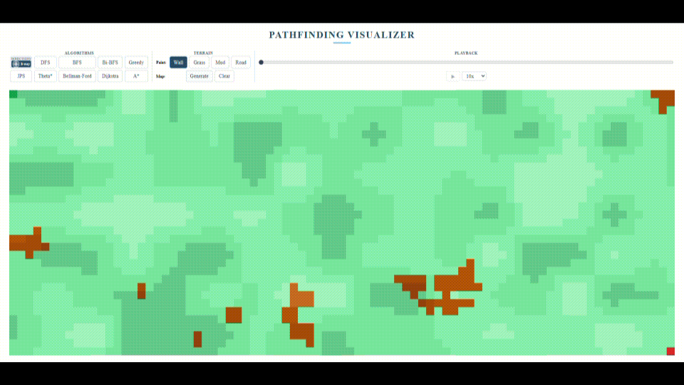

# Pathfinding Visualizer

An interactive web application for exploring how different pathfinding algorithms search a grid and how their results compare across different terrain types.

**[Try the live demo](https://chrisp-bacon2024.github.io/pathfinding-visualizer/)**




## About the Project

I created this Pathfinding Visualizer to learn more about graph theory and different pathfinding algorithms, and to build a portfolio project that demonstrates how the algorithms compare across generated or manually painted terrain.

One of the most difficult parts of developing it was deciding how to represent the data that the algorithms would use. Since I initially had limited knowledge of how these algorithms worked, I decided to represent both the grid and its individual cells as classes, with attributes and methods that would make implementing the algorithms easier. As I implemented more algorithms, I began to recognize the common structures and operations they required, making each subsequent implementation easier.

I'm most proud of being able to compare the paths generated by different algorithms. Seeing their paths side by side makes it much easier to understand the relative strengths and weaknesses of each approach.

## Features

- **Nine pathfinding algorithms** with animated frontier and visited-cell exploration.
- **Interactive terrain editing:** paint walls, grass, mud, and roads; move the start and end points; or generate a random map.
- **4-way and 8-way movement**, with diagonal corner-cutting prevented. Theta* is available in 8-way mode.
- **Playback controls:** play, pause, replay, change speed, and scrub backward or forward through the search.
- **Side-by-side path comparison:** keep multiple algorithm paths visible at once, with offset lines where paths overlap.
- **Run statistics:** compare path cost, moves, cells explored, and computation time.
- **Responsive controls** supporting mouse, touch, and pen input.

## Algorithms

| Algorithm | What it demonstrates | Terrain costs |
| --- | --- | --- |
| Depth-First Search (DFS) | Stack-based graph exploration | No |
| Breadth-First Search (BFS) | Fewest-move paths on an unweighted grid | No |
| Bidirectional BFS | Searching from both endpoints | No |
| Greedy Best-First Search | Heuristic-guided exploration | No |
| Jump Point Search (JPS) | Jump-based grid search (simplified implementation) | No |
| Theta* | Any-angle paths using line-of-sight checks | No |
| Bellman-Ford | Repeated edge relaxation for weighted paths | Yes |
| Dijkstra's Algorithm | Lowest-cost paths through weighted terrain | Yes |
| A* Search | Lowest-cost paths using a distance heuristic | Yes |

**Note:** Not every algorithm optimizes the same objective. For example, BFS minimizes the number of moves, Dijkstra and A* account for terrain costs, and Theta* uses geometric distance. This is part of what makes comparing their results interesting.

## Technologies and Design

Built with **JavaScript (ES modules), HTML, CSS, and the Canvas 2D API**, without a frontend framework or runtime dependencies.

The application separates the grid and cell models, pathfinding algorithms, animation playback, and rendering. Algorithms operate on a shared grid representation and produce search steps; the animation system plays those steps back independently. A custom binary min-heap supports priority-queue-based searches, while a separate canvas overlay draws the resulting paths, including straight-line Theta* segments.

## Testing

The project includes automated tests using Node.js's built-in test runner. They cover path legality, weighted shortest paths, movement restrictions, heuristics, line-of-sight geometry, playback, and path rendering. Tests also compare algorithm results against independent reference implementations on reproducible grids.

Run the tests with:

```bash
npm test
```

## Run Locally

Clone the repository and serve the project directory with a local HTTP server. For example, with Python installed:

```bash
python -m http.server 8000
```

Then open `http://localhost:8000` in your browser. A local server is needed because the application uses JavaScript ES modules.

## Live Demo

**[Open Pathfinding Visualizer](https://chrisp-bacon2024.github.io/pathfinding-visualizer/)**
